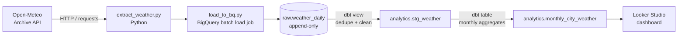
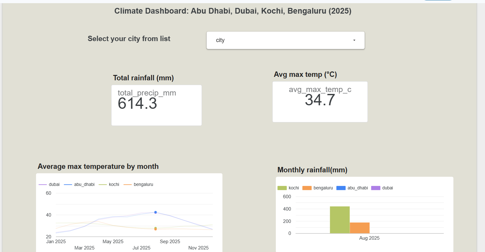

[README (1).md](https://github.com/user-attachments/files/33301511/README.1.md)
# Weather ELT Pipeline on GCP

An end-to-end ELT pipeline that pulls historical daily weather data from a public API, loads it into **BigQuery**, models it with **dbt**, and serves it in a **Looker Studio** dashboard.

Built as a personal portfolio project on public data, using only free-tier GCP (BigQuery sandbox, no billing account).

## Architecture



## Tech stack

| Layer | Tool |
|---|---|
| Source | Open-Meteo Archive API (no API key) |
| Extract / Load | Python 3.12, `requests`, `google-cloud-bigquery` |
| Warehouse | BigQuery (sandbox) |
| Transform and test | dbt Core (`dbt-bigquery`), `dbt_utils` |
| Visualization | Looker Studio |
| Version control | Git, GitHub |

## Dashboard



## Data model

| Table | Type | Description |
|---|---|---|
| `raw.weather_daily` | table | Raw daily records per city, loaded as-is. Append-only, with a `loaded_at` timestamp on every row. |
| `analytics.stg_weather` | view | Deduplicated daily weather (one row per city and day, keeping the latest load). |
| `analytics.monthly_city_weather` | table | Monthly average max/min temperature and total rainfall per city. |

**Cities:** Abu Dhabi, Dubai, Kochi, Bengaluru. **Period:** calendar year 2025 (the extract takes any date range).

## Data quality

dbt tests run against the staging model:
- `city` is not null
- `weather_date` is not null
- the combination of `city` and `weather_date` is unique

## Design decisions

- **Idempotent reloads:** the raw table is append-only, so re-running a load never loses data. The staging model deduplicates with `row_number()` ordered by `loaded_at`, so reruns do not create duplicate days downstream.
- **Explicit schema on load:** columns are typed explicitly (for example `date` is a `DATE`) rather than auto-detected, so types stay stable between runs.
- **Batch loads, not streaming inserts:** loads use BigQuery load jobs, which work in the free sandbox.
- **Staging as a view, marts as a table:** cheap and always current for staging, with the aggregated mart materialized for dashboard speed.

## Project structure

```
weather-elt-gcp/
├── extract/extract_weather.py     # API calls, returns rows
├── load/load_to_bq.py             # loads rows into BigQuery
├── dbt_weather/
│   ├── models/staging/            # stg_weather.sql, schema.yml (source + tests)
│   ├── models/marts/              # monthly_city_weather.sql
│   └── packages.yml
├── tests/
├── docs/images/
└── requirements.txt
```

## How to run

**Prerequisites:** Python 3.12, Google Cloud SDK, a GCP project with BigQuery enabled.

```powershell
# 1. Set up the environment
py -3.12 -m venv venv
venv\Scripts\Activate.ps1
pip install -r requirements.txt

# 2. Authenticate and create the datasets
gcloud auth application-default login
gcloud config set project YOUR-PROJECT-ID
bq mk --dataset YOUR-PROJECT-ID:raw
bq mk --dataset YOUR-PROJECT-ID:analytics

# 3. Extract and load (set PROJECT_ID in load/load_to_bq.py first)
python -m load.load_to_bq 2025-01-01 2025-12-31

# 4. Transform and test with dbt
cd dbt_weather
dbt deps
dbt run
dbt test
```

dbt connects through your `~/.dbt/profiles.yml` using `oauth` authentication, so no key files are stored in the repo.

## Roadmap

- [ ] Orchestrate the pipeline with Apache Airflow
- [ ] Add CI with GitHub Actions (lint and unit tests)
- [ ] Add a Cloud Storage raw landing layer (requires billing)
- [ ] Convert the raw load to an incremental dbt model

## Notes

BigQuery sandbox tables expire after 60 days by default, so the live dashboard is replaced here with screenshots.

## Author

Sona Jose, data engineer. Cloud and data engineering, GCP, Python, SQL.
